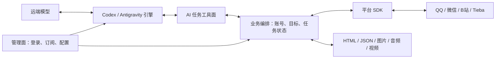

# Glimlink: Agent Runtime architecture

状态：定位、任务工具面与模块边界。当前实现和验证边界以 [项目 README](README.md)、实际工具注册表及[验收记录](docs/validation.md)为准。本文的能力目标不等于全部已经完成。

## 产品定位

取舍标准：把 AI 会做的事情，变成不值得让 AI 每次亲自去做的事情。可确定、可重复、可核验的协议及处理步骤由代码承担，AI 保留内容理解、目标选择和行动决定。

Agent Runtime 是供 AI 使用真实账号的轻量社交客户端内核。它负责持续维护账号、识别平台内容和操作对象，并把社交任务变成可直接调用、结果可辨认的工具。AI 决定读什么、看哪里、说什么和采取什么动作；Runtime 完成平台协议、目标核验、资源处理和操作回读。

核心价值是降低 AI 的使用摩擦、提高操作成功率和结果可辨识度、减少完成任务需要的底层步骤。SDK 调用成功或开发者现场编写 HTTP 脚本，只能证明局部协议可行，不能证明未来 AI 已能通过 Runtime 完成任务。

产品契约包括五部分：

- **账号连续性**：复用已保存的真实账号会话，维护身份与引用的归属，明确区分本地已保存、服务端已核验和需要重新登录。
- **语义内容**：保留作者、会话、帖子、回复、时间及媒体关系；平台未知字段和未展开内容明确标记。
- **任务动作**：提供打开内容、读取讨论、查看通知、观看媒体和发送回复等入口，内部吸收签名、分页和资源流水线。
- **可信状态**：区分未执行、已尝试、明确失败、结果未知、已回读验证，以及媒体取得、解码和实际提交模型。
- **资源约束**：整个运行系统以 512 MiB VPS 为目标，控制常驻连接、上下文、缓存和媒体处理峰值。

QQ、微信以聊天为核心；Bilibili 包含实际视频观看及互动；Tieba 包含帖子与讨论。图片、语音、音视频属于内容本身，不能只保留一个链接、占位符或转写就宣称已经理解。

- 目标环境是总内存 512 MiB 的 VPS；本机编译不设内存上限，开发与真实账号联调继续在 Docker 中隔离。
- 最终运行时以完全 Rust 为目标，统一管理、统一部署。远端模型负责推理，VPS 负责协议、调度、内容整理和必要的媒体处理。
- VPS Runtime 不嵌入 V8、Blink、Chromium 或其他浏览器内核；不安装完整桌面客户端作为适配层。操控端可在登录期间按需使用本机系统 WebView，认证交互结束即关闭；GUI 依赖不得进入 Runtime 的构建依赖。
- 保留 Codex、Antigravity 的订阅登录目标。登录可用性、嵌入方式和实际输入能力须分别验证，不能由底层模型名称推定。
- QQ、微信聚焦聊天，不做小程序。Bilibili 的首轮适配必须包含真实视频观看。

## 管理面、AI 任务面与实现分层

管理面负责部署、启用模块、账号登录、订阅认证、私有状态和诊断。平台二维码、Cookie、BDUSS、同步密钥及引擎凭据在这一层保存；业务模型只需知道账号别名、身份和可用状态。登录入口没有注册成业务工具并不构成业务能力缺失，也不要求向模型开放凭据。

AI 默认使用任务工具面。一次任务调用应在授权范围内复用账号、解析目标、调用必要的业务能力，并返回结果及可继续使用的引用。底层 SDK、历史 CLI 和细粒度 routes 继续保留，供实现、调试和兼容使用；不要求模型先查接口文档、理解签名、拼接认证 URL 或选择解码器。

| 层 | 职责 | 面向 AI 的边界 |
| --- | --- | --- |
| 管理面 | 登录、凭据、订阅认证、部署、模块启停和诊断 | 可查询状态；私有认证材料不进入普通上下文 |
| AI 任务面 | 提供目标明确、参数有限的社交动作和媒体读取工具 | 默认入口；返回语义对象、后继引用和可信状态 |
| 业务编排 | 选择账号、绑定目标、展开上下文、分页去重、组织媒体、记录发送并回读 | 吸收机械步骤，不让模型重建平台客户端 |
| 平台 SDK | 平台协议、签名、会话、请求、内容字段及媒体定位 | 通过编排调用，保留平台特有语义 |
| 内容处理 | HTML / JSON 投影、图片、GIF、音频及视频处理 | 只处理已授权资源，报告实际输入和处理缺口 |
| 人格与记忆 | 管理面人格、Agent 岗位、带来源和版本的记忆、会话近期对话 | 所有人格指令由管理面提供，普通记忆作为数据按需召回 |
| Agent 引擎 | 订阅认证适配、上下文、工具协议、流式回合和取消 | 按当前通道的真实输入能力提交内容 |

共享核心提供账号作用域、不透明引用、持久状态、预算和调度。它支撑各层，不代替平台语义。

## 模块化方式

这里的 Plugin 指能力模块。默认采用 Rust workspace、窄接口、Cargo features 和编译期注册，最终组成一个 Runtime。第一版不建设动态插件 ABI、插件市场、每模块常驻服务或通用浏览器兼容层。

模块多不要求全部保持活跃：平台连接按账号启用，媒体任务按需执行，模型任务先串行调度。需要隔离高内存解码时，可以启动同一程序的短生命周期工作进程；其内存也计入总预算。

| 层 | 模块示例 | 职责 |
| --- | --- | --- |
| 平台适配 | `platform-qq`、`platform-weixin`、`platform-bilibili`、`platform-tieba` | 登录与续期、拉取与同步、平台内容语义、媒体定位及必要解密、发送和其他平台操作 |
| 内容处理 | `content-html`、`content-json`、`media-image`、`media-audio`、`media-video` | 解析和整理可读内容，处理真实媒体，提供原始来源及细节的按需读取 |
| Agent 引擎 | `engine-codex`、`engine-antigravity` | 订阅认证适配、上下文与工具协议、模型输入能力、流式响应及取消 |
| 共享核心 | `runtime-core`、公共类型与资源管理 | 调度、事件与动作路由、账号隔离、能力查询、资源引用、缓存预算和发送记录 |

这些是逻辑边界。初期可以用一个 crate 的子模块表达，边界稳定或确有独立依赖时再拆 crate，避免为了名字提前拆出大量空包。

平台输入经标准化进入上下文；模型发起的动作经共享核心路由回平台。平台不直接绑定某个模型，媒体模块也不持有平台登录流程。

## 默认任务工具面

工具数量随实际需要调整，不把每个 SDK 方法都默认注册给模型，也不做用任意字符串执行任意操作的万能工具。当前收拢的职责如下；实际名称、参数和是否可调用以当前构建的 `tools` 注册表为准。

| 工具 | 任务职责 |
| --- | --- |
| `social_open` | 打开视频、帖子或已有目标引用，返回可读正文、作者、统计及相关对象引用 |
| `social_creator_content` | 从视频或作者引用读取作者的其他内容，内部解析作者身份 |
| `social_discussion` | 读取讨论或指定回复上下文，保留楼层、根评论及父回复关系 |
| `social_notifications` | 读取互动通知，返回可继续打开的关联目标；明确读取副作用边界 |
| `social_publications` | 读取当前账号本人发布的内容，核对作者归属 |
| `social_emotes` | 读取原生表情面板，用包引用及后继引用选择精确 token 和按需图片 |
| `social_send` | 在当前已支持范围内发送或回复，内部完成目标核验、必要上传、操作记录和回读 |
| `social_like` / `social_follow` | 正向设置点赞或关注状态，区分已经满足、实际写入和结果未知 |
| `media_read` | 按引用读取一种媒体，内部获取资源、探测实际格式、选择受限处理路径并准备引擎输入 |
| `media_watch` | 从视频目标读取指定时间窗，内部组织视频、音轨、帧和覆盖记录 |
| `runtime_expand` | 按需读取原文、脚本、样式、嵌入状态或大结果的有界部分 |

账号、模块能力、平台表情、搜索和发现保留明确的辅助入口。上述职责不意味着每个平台已经支持所有动作；QQ 未支持的附件、微信暂停、未知对象类型或未实现动作都应返回相应状态，不能把请求降成空结果或假成功。

AI 可以决定是否展开脚本、样式或媒体，以及时间窗、采样精度和读取范围。Runtime 负责把选择转换成确定的处理流程，不能让 AI 为查看同一张图片先猜平台下载方法、复制缓存 ID、检查扩展名，再选择解码器。

业务验收从注册工具入口开始：给定已保存账号及一个普通链接或目标引用，模型无需私有 HTTP 请求、shell 脚本或手工查 UID 即可完成已支持任务，并能辨认成功、失败、未知及未观察内容。SDK 测试和人工协议探针仍是开发证据，但不能替代这一验收。

## 公共内容与资源结构

公共结构采用带类型的内容块，HTML 是其中一种阅读投影，不是所有内容的底层存储格式。

| 结构 | 必需信息 |
| --- | --- |
| 事件 / 消息 / 文档 | 来源平台与账号、稳定对象 ID、作者、会话或帖子、时间、回复关系、内容块 |
| 内容块 | 文本、HTML、JSON、图片、音频、视频、引用等类型；媒体通过资源引用关联 |
| 目标引用 | 不透明 ID、平台、已核验对象身份、所属账号及允许的后续动作 |
| 资源引用 | 不透明 ID、所属账号、来源、格式、大小、有效期、可用变体和可读取范围 |
| 后继引用 | Runtime 保存的分页状态、账号与对象归属、去重记录、进展和停止原因 |
| 媒体观察记录 | 实际提交的图片、帧时刻、音频区间、片段偏移、处理方式、失败或未处理区间 |
| 动作与结果 | 平台、账号、目标、操作类型、参数、操作 ID；区分成功、明确失败、结果未知 |

资源引用在 Runtime 内解析。平台票据、解密密钥和带认证的临时 URL 不作为普通页面内容交给模型；过期 URL 可以重新获取而不改变内容身份。资源被淘汰后返回明确状态，不能把旧引用指向新内容。

当前任务目标按账号、平台、类型和内容复用引用。新任务引用使用固定24小时有效期；定位器接近条数或字节上限时，内部任务缓存和后继引用优先回收，目标最后回收，最近256个新建或复用的任务引用受保护。旧媒体定位器、账号和操作记录不参与这项回收。缓存淘汰只使旧引用失效，不会把它改指向另一个对象；模型无需逐条管理内部引用。媒体下载与视频轨道的短期复用另有300秒刷新窗口。

账号随目标、媒体和后继引用保存。显式账号必须与引用归属一致；无引用时优先使用明确指定的账号，只有一个已保存账号时可自动选择，多账号不猜测。对象作者与操作账号分别表示，转发作者、原作者和合作作者也不混用。

分页由业务编排处理：保留服务端原始状态，在 Runtime 内识别重复项目和没有进展的页。模型只传回后继引用，无需拼接游标字段或实现 rpid 去重。缺少可信结束标志时保留未知；预算耗尽、被截断、过期或没有新增项目时给出原因，不能伪造安全的续页。

共享接口按用途分别设计，不做一个包含所有平台功能的巨大 `Plugin` trait：

- 平台接口：查询能力、恢复会话、收取事件、拉取对象、解析资源、执行平台动作。平台特有操作可以使用带命名空间的强类型扩展。
- 内容接口：探测格式、生成有界投影、读取原文、准备媒体输入；视频另提供按时间段读取、跳转与回看。
- 引擎接口：认证状态、实际可用的输入与工具能力、运行一轮、流式输出和取消。

能力状态应分别表达实现范围、当前可用性和验收证据，区分“设计目标”“已接入 Runtime”“仅实验”“当前账号及引擎已验证”“暂停”“不可用”和“结果未知”。例如 QQ 旧实验文本能发送，不等于新主程序当前账号已通过登录验收；引擎能看图片，不等于能接收原生视频。一次工具调用得到结构化结果，也不等于其中的写操作或媒体理解已经成功。

## HTML、JSON 与依赖 JS 的内容

HTML 模块整理正文、链接、表单和媒体引用；JSON 模块负责结构解析、有界查询与投影。字段的业务含义由平台模块解释，不能期待通用 JSON 模块自动理解所有平台。

默认提供可阅读的正文和资源索引，同时保留原始 HTML、脚本、样式、嵌入 JSON、页面状态或可获得的组件结构引用。AI 可以按需选择读取，返回结果带截断和范围信息。QQ 的协议消息可以直接生成标准消息，不必绕一遍 HTML。

依赖 JS 的内容分三类处理：读取页面已有的嵌入状态；由平台模块直接请求相应数据接口；将必要的小段平台算法用 Rust 实现。脚本源码也可以作为资料供 AI 读取。读取脚本不意味着执行整个页面；没有浏览器时无法恢复的行为应明确报告缺口，不能伪造组件树或页面内容。

## 图片、音频与视频

共用路径为：平台资源引用 → 有权限的流式获取与必要解密 → 有界磁盘缓存 → 按需探测和处理 → 引擎支持的真实媒体输入。

这条流水线由 Runtime 编排，默认不拆成必须由 AI 串联的步骤。细粒度下载和解码 routes 保留用于调试、组合及兼容；模型通过 `media_read` 或 `media_watch` 选择具体内容和观察区间。已有缓存尽量复用，媒体仍只在明确选择后获取。

下载成功、解密成功、解码成功、提交模型成功和理解结果是不同状态。不能把 URL、文件名、alt 文本或已有字幕当作媒体已进入模型的证据。

### 图片

保留原图引用，按需要提供缩放图、裁剪细节和动图帧。限制输入宽高、像素数、解码分配与输出数量；缩小输出图不代表原图解码没有峰值内存。模型可请求更高分辨率或局部重读。

### QQ 与微信音频

首轮媒体需求包含接收语音消息、取得真实音频、按当前引擎能力读取声音，并关联原消息、时长及时间位置。语音转写是辅助内容；环境声、音乐、语气等有意义时仍需声音输入，不能一律降成文字。

平台模块负责定位、下载和必要解密；音频模块负责格式探测、受支持编码的读取、分段及必要转换。SILK、AMR 等格式要按实际协议和纯 Rust 实现逐项验证，不能用一个通用“支持音频”开关覆盖未知编码。

保留原音频和已有转写的来源。长音频分段时保存绝对时间、段间连续性和未处理部分。发送语音、发送普通音频文件与接收语音是独立能力，分别实现和验收。

### Bilibili 视频观看

B站首轮必须能打开实际视频、获取画面和声音，按时间轴分段观看，跳转、回看，并结合评论上下文。纯标题、字幕或首尾几张关键帧只能算预览。

1. 平台模块提供视频身份、分 P、清晰度与编码变体、音视频轨道、字幕及资源续期。优先选择适合本地预算的低分辨率编码流。
2. 如果实际订阅引擎支持原生视频，流式提交真实片段，确认输入完成，保存时间偏移和音轨对应关系。
3. 如果引擎不支持原生视频，使用已验证的 Rust 解码路径，按连续时间窗口提交真实画面与音频；需要时提高采样密度、分辨率或裁剪细节。引擎或可选服务没有音频理解能力时，明确暴露缺口，不把字幕当作声音。
4. 保存画面采样和音频覆盖记录，支持向后继续和按区间重看。完整解码、抽样观察、模型内部采样各有边界；处理到片尾也不能声称每一帧都被模型观察。

图片、语音和视频共用资源管理、缓存、时序信息和引擎输入适配。每种 codec 可以独立开关，避免为了支持一个平台装入整套播放器或转码套件。

当前共享媒体模块采用固定 Rust 解码实现；实现范围见[媒体模块](crates/runtime-media/README.md)，实际采样覆盖与内存测量见[验收记录](docs/validation.md)。

## 引擎与订阅登录

引擎模块保留各自的订阅登录、续期和账号边界，将平台工具及公共内容转换为该引擎实际接受的格式。认证材料不进入公共内容结构。

内嵌不等于把完整 CLI 的运行环境和依赖原样常驻。优先复用或精简可嵌入实现；需要重写的部分使用 Rust，并单独验证与订阅认证流程的兼容性。VPS Runtime 继续不含浏览器内核；登录所需 WebView 只能在操控端的独立进程按需启动。OAuth 若要求系统浏览器，继续使用系统浏览器，不把授权页面强塞进 WebView。平台连接的出口及原生设备身份不会仅因交互窗口在另一台电脑而改变。

Codex 和 Antigravity 的订阅认证适配、允许的嵌入方式、图片/音频/视频输入、上下文限制均是独立验收项。底层模型的 API 文档不能证明订阅通道具有同样能力，也不能把另需付费的 API 默认为订阅替代品。

Codex原生app-server与标准MCP复用同一任务面。MCP支持2026-07-28及2025-11-25、2025-06-18兼容；协议层只负责有界帧、目录/schema、身份与内容转换，不另造业务路由。原JSONL保留。登录材料在专用`CODEX_HOME`，0.165.0/gpt-6.1-sol订阅已通过真实Runtime工具与图片回合；不接收原生音视频。宿主使用完整的固定Direct模型目录，不合并远端更新；不启动含V8的独立code-mode host。Antigravity通过同一原生agy1.4.11的ACP接入，个人Google订阅缓存、Rust MCP工具桥和跨引擎人格/记忆已完成真实验收，直接媒体输入仍未验收。

## 512 MiB 运行约束

预算覆盖 VPS 系统余量、Runtime、启用的平台连接、当前引擎及媒体处理的合计峰值；不能给每个模块各算 512 MiB。编译内存不属于这项预算。

- 初期同一时间执行一个模型任务、一个媒体处理任务；事件队列和待发送上下文都有上限及背压。
- 下载、解密、上传使用小缓冲并尽量流式落盘，不把整段视频或其 Base64 副本常驻内存。磁盘缓存有大小、有效期和账号归属限制。
- 解码从所选小尺寸编码流开始，限制参考帧、图片像素、片段长度和同时保留的结果。避免收集整段动图或视频的所有解码帧。
- 无法满足预算的变体应选择更小变体或返回明确缺口，不能静默启用大依赖、无限队列或额外 swap。
- 模块单测不能证明整体达标。先实测最小 VPS 系统及必要守护进程的基线并预留余量，再为整个应用设置更低的总内存上限；所有工作进程一并计入。最终使用总内存 512 MiB、无额外 swap 的虚拟机或 VPS，结合真实媒体和实际引擎任务验收峰值、延迟、失败恢复及资源释放。只给应用容器设置 512 MiB 上限，不能证明整个 VPS 达标。

暂不承诺尚未测量的每模块常驻数值。QQ 原型目前约 3 MiB 收包、约 60 MiB 登录/发送峰值，只代表该实验，不能充当完整 Runtime 的测量结果。

## 当前状态与实施顺序

| 平台 / 部件 | 当前证据 | 后续验收重点 |
| --- | --- | --- |
| QQ | 协议库已链接主程序；票据/TempPwd、单后台连接、持久收件箱、会话引用及一次性文本发送已接任务面；旧实验实号发送证据保留 | 新主程序实号与跨夜重连验收，图片/语音/视频；纯 Rust 签名仍未完成 |
| GitHub | 独立应用模块已接共享账号、MCP、引用、分页及 Outbox；仓库、Issue/PR、评论、通知与按需文件/改动 | 真实账号权限与评论验收；大仓库、变动中PR与限流恢复 |
| Bilibili | 主要读取、登录、本人投稿、互动通知、评论/图片/GIF、正向点赞关注已接入；实际证据见各验证记录 | 默认任务面及其闭环验收；作者其他内容、搜索、长期续期和声音理解各自验证，不由 SDK 成功推定 |
| Tieba | 登录、本人内容、帖子、楼中楼、通知和取图已接入并有实网证据；最新本人主题回复已实现但用户确认首次未实际发出 | 写入仍未验收，保留未知记录；任务引用、长期续期、通知副作用及更多媒体 |
| 微信 | WebWx 接口已实现，两次真实扫码确认后的登录均被拒绝；用户报告新设备扫码登录被限15天，已暂停 | 默认不编入客户端，不再请求、轮询、切换入口或自动重试；用户决定恢复后再研究个人号协议与聊天，Bot 通道不能替代 |
| 两套 Agent 引擎 | Codex订阅文本/工具/图片通过；Antigravity原生ACP订阅文本/工具通过，两者共享人格与记忆 | 长期会话与完整VPS组合测量；Antigravity媒体输入、原生音视频及声音理解仍缺 |

实施顺序以AI能直接完成任务为标准：已收拢任务入口、账号选择、引用、媒体编排和分页状态，并接入MCP；继续通过相同入口验证正常、失败、未知和恢复路径。QQ文本能力和GitHub任务入口已迁入，继续验证真实账号、声音理解及订阅回合，再扩展平台动作和编码。微信继续保持暂停，恢复由用户决定。

现有 QQ 实验中已确认的两次自发测试记录继续保留；模块迁移和重连不得重新发送。发送动作复用持久化操作记录，结果未知不能简单重试。

## 研究依据

- [QQ 协议模块与来源](crates/platform-qq/README.md)、[第三方声明](crates/platform-qq/NOTICE)。
- [媒体模块](crates/runtime-media/README.md)、[Rust 解码来源](crates/runtime-media/vendor/PROVENANCE.md)。
- [微信接口范围](crates/platform-weixin/README.md)、[数据来源](crates/platform-weixin/NOTICE)。
- Bilibili 社区协议参考：[扫码](https://github.com/bilibili-plugins/bilibili-api-collect/blob/master/docs/login/login_action/QR.md)、[WBI](https://github.com/bilibili-plugins/bilibili-api-collect/blob/master/docs/misc/sign/wbi.md)。这是逆向协议资料，不是平台官方稳定性承诺。
- Tieba 客户端维护者资料：[aiotieba](https://github.com/lumina37/aiotieba)、[接口文档](https://aiotieba.cc/ref/client/)。

GitHub 使用独立应用任务入口，复用客户端内核，保留仓库/Issue/PR/提交/文件/行内评论各自语义，不强行投影成社交平台帖子。文件引用冻结提交，PR改动固定head/base快照；Link仅作为分页提示，下一请求仍由固定SDK方法构造。

## 持久任务与来源宿主（2026-10-30）

已实现 `runtime-jobs`、`agent_sources`、`agent_host` 和管理CLI。来源先保存pending批次，任务入队完成后才确认checkpoint；单个租约控制running任务，工具前持久保存线程/回合及操作身份。模型按任务启停，默认0监听，暂无默认自动发送策略。CLI管理无需持有业务Runtime锁，业务内核与模型执行仍由一个宿主串行拥有。

运行中断、模型断开及持久化失败保留Interrupted，不改成Pending。认证恢复只对无模型线程/工具证据的NeedsAuth开放，可取消未执行任务。Completed与动作证据分开，宿主与指定job状态自动汇总所有动作；未决或服务器确认不会冒充精确回读，也不会重发。

通知watch持久保存旧头锚点、追赶页与暂存前缀，连接到旧边界后才释放未知实体；已知实体新版本独立处理，B站latest/total分区不互相冒充边界。每轮最多一页20项，最多32页、128事件/192KiB缓冲；无法证明时halt/gap，不承诺完整历史或所有底层更新。buffer随pending批次及已入队任务正确保护/弃置；管理resume保留游标与去重，不能代替reset。QQ仍使用本地基线与增量游标。来源故障与任务执行隔开，多来源轮流读取；保护信息不可读时GC停删。

真实订阅短回合不代表长期可用。会话连续性由下节的Runtime近期对话和共享记忆承担，不再要求固定复用原生thread；旧job关联真实动作证据。长期排队引用保鲜、整套磁盘预算和完整512MiB VPS组合测量仍待完成。Antigravity媒体输入、声音理解、QQ新登录及跨夜连接仍需完成；微信保持暂停。

## 共享人格、岗位与记忆（2026-10-30）

人格和记忆属于 Runtime，模型引擎只消费当前上下文。`AgentContext {persona, agent, conversation}` 在任务入队时持久固定；缺省为 main/main/None，旧任务可以读取。共享人格只以persona标识，岗位按agent标识配置，近期对话按persona与conversation保存。来源中的身份只能由管理配置选择，正文与工具参数不能覆盖。QQ会话键来自账号与协议解析的真实对象，不依赖会过期的target_ref；通知默认没有近期对话，显式会话仍按平台和账号分隔。

`mind_store` 用一个私有有界JSON保存人格、岗位和记忆。管理面写入人格/岗位，模型只维护普通记忆。每条记忆记录来源、写入Agent/job、时间、可见性和单调版本；创建/修改/删除都检查预期版本，删除后重建不复用旧版本。不同persona隔离；同persona的shared记忆共享，conversation记忆只在完全匹配的会话可见。模型不能冒充operator，也不能覆盖operator记忆。

`agent_dialogue` 独立保存近期对话，每会话最多8轮/16KiB，不保存完整平台日志。执行身份区分显式GC后复用的job ID；同一次记录重试幂等。历史包含任务、短回复、状态和有限动作ID，完整证据仍以Queue和Outbox为准。模型回合完成后在锁内核对开始时的history epoch，重置过的旧回合不写回；持久化失败单独报告，不重新执行已完成任务。会话清空不会抹掉未决操作，保留槽位，目前没有会话槽位GC。

`agent_mind` 统一构建引擎输入：人格和岗位进developer instructions；召回记忆、近期对话、来源事件作为有归属的数据；同会话旧任务有动作时附最多3个任务的实际账本摘要，并提供独立状态查询。每次新建原生模型线程并记录persona/role/memory版本和history epoch，后续任务能取得新配置，无须依赖原生线程格式。记忆不授予权限，也不作为发送回执。

Codex动态工具与MCP共用 `runtime_memory` 的context/search/get/remember/forget。外部MCP客户端收到加载上下文的说明，但仍由客户端决定采用人格的方式，服务端无法提升自己的指令优先级。跨引擎共享的是数据与上下文协议，表达一致性并无保证；Codex与Antigravity都已完成真实文字/共享记忆验收，媒体输入分别列示。

默认共享数据在本Runtime状态根下；可用显式绝对路径 `--mind-state` 让不同本地Runtime共享同一记忆根，自己的账号/队列/Outbox/近期对话继续独立。短事务锁和版本检查支持跨进程写入，但不提供跨机器复制或互不信任租户的访问控制。第一版不引入embedding、向量库、第二个模型或后台记忆服务，中文双字/词项及标签按需检索。

预算：16个人格（每个4KiB）、32个岗位（每个2KiB）、512条记忆（每条2KiB），共享提交JSON最多2MiB；单次记忆文字召回6KiB、快照16KiB。近期对话另限128个会话、提交JSON2MiB。两类文件原子替换各预留至多2MiB临时空间，拒绝容量超限，不自动挤掉其他会话。遗忘只移除活跃记忆，不声称擦除旧上下文、原生rollout或备份。

## Antigravity 原生ACP与同一Runtime（2026-10-30）

`agent_antigravity`复用任务队列、共享上下文、工具选择、持久工具派发和会话收尾。管理端按次选择引擎，认证通过并开始执行时将engine固定写入job。显式单回合请求先创建自己的job，再按ID claim；不会消费其他排队任务。已有执行证据的任务不可换引擎重放。

`runtime-engine::AntigravityClient` 使用同一官方原生ELF的 `acp` 子命令，经协议能力核验系统提示追加。人格/岗位走 `_meta.antigravity.systemPrompt.append`，普通记忆/近期对话仍是独立数据。`session/new`复用原生Google缓存，普通运行不发authenticate；独立管理登录提供官方Google OAuth URL/code流程，凭据留在专用HOME，Rust不解析认证内容。认证阻塞时没有模型prompt或业务调用，可以显式恢复；创建session之后的错误保留失败/中断，不当作从未执行。

执行中只向原生CLI提供一个Runtime MCP server。MCP子进程是相同Rust程序的纯stdio↔Unix socket代理，不打开第二个Runtime或账号锁。父宿主每25ms轮询协议及桥请求，业务处理始终串行在已有Runtime上执行；请求容量1、帧1MiB、最长600秒，有背压、超时与退出清理。原生session、Runtime的prompt请求身份和动作ID在工具前持久保存，两套引擎不维护两份Outbox。ACP未提供独立服务端turn ID，Runtime使用acp-请求序号作本地回合身份。

固定版本用 `_meta.disableBuiltInTools=true` 禁用内置工具；`--include-default-customizations=false`、托管权限配置及客户端拒绝权限/文件/终端请求共同限制入口。默认组件不参与人格/记忆装配，原生CLI及MCP代理只在任务期间存在。无Node或浏览器接入依赖；agy原生文件包含Go/Rust/C++，适配、桥接和Runtime业务为Rust。

Go部分有128MiB软内存目标、GOGC=60，外层继续限制整个进程树及文件缓存。退出引擎后对只读可执行文件做POSIX_FADV_DONTNEED提示，回收可释放的旧引擎文件页；这是内核可忽略的优化，不改变任务结果，仍被其他进程映射的页不会强制移除。进程RSS、匿名内存及文件缓存分别测量，不能将文件映射RSS与同一份page cache重复相加。

当前只接受已验收文字与Runtime工具；直接图片/音频/视频在适配器明确拒绝。MCP图片返回与模型实际读懂媒体分开验收。整体VPS系统基线、QQ长期连接/签名及媒体压力仍需组合测试，单次订阅通过不能证明所有负载均适配512MiB。
